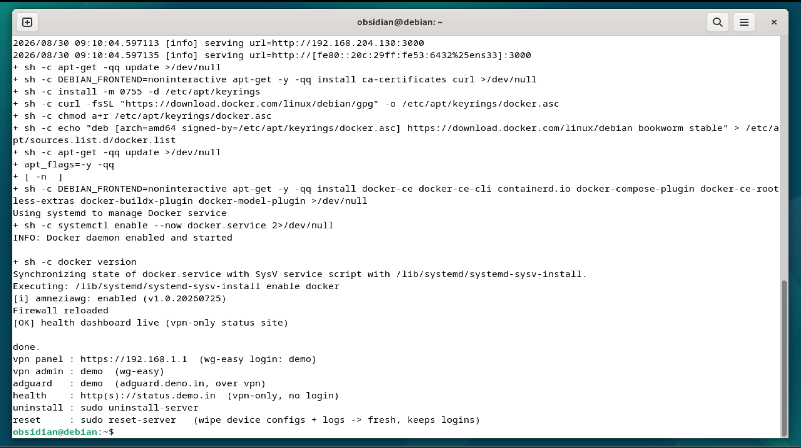
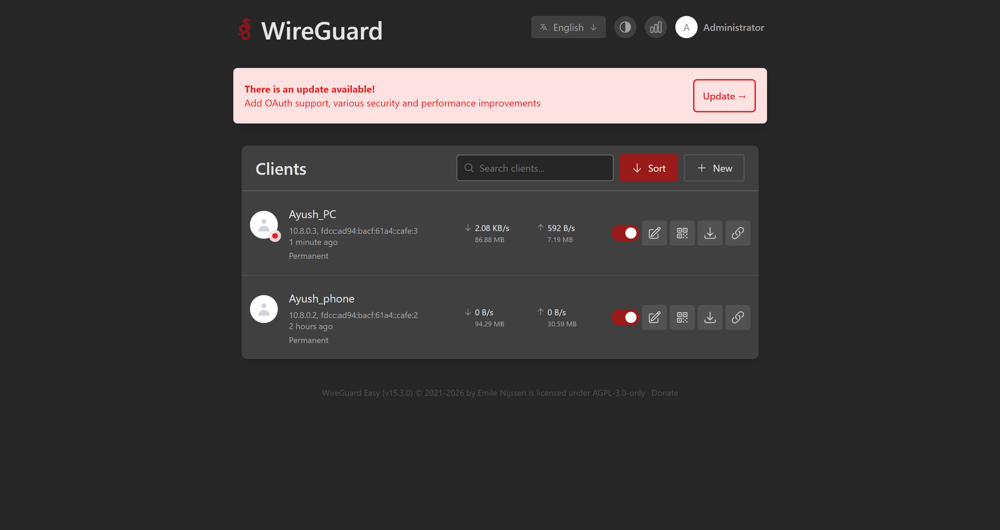
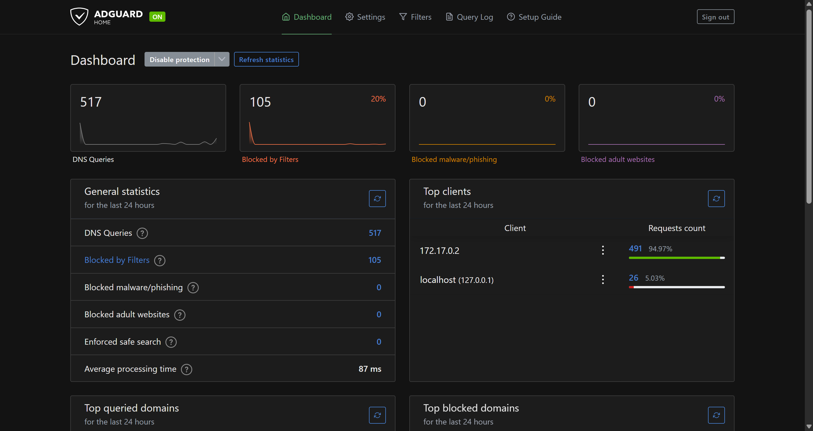
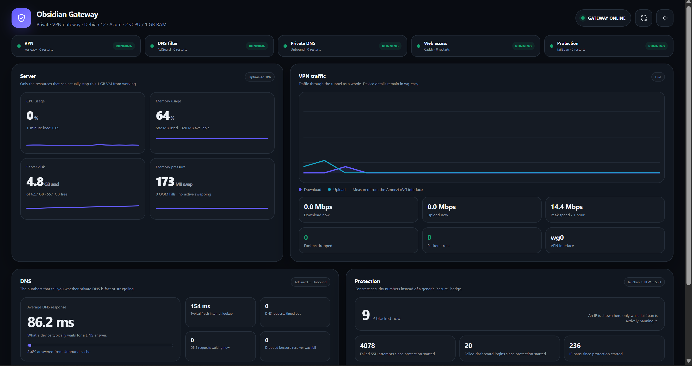

# 🗿 Obsidian

> **Self-hosted private internet gateway — obfuscated VPN that defeats DPI, recursive DNS from root servers, and network-wide ad blocking. One command on any Debian 12 Machine.**

[](https://docs.amnezia.org/documentation/amnezia-wg/)
[](https://www.debian.org)
[](https://www.docker.com)
[](https://caddyserver.com)
[](https://adguard.com/en/adguard-home/overview.html)
[](LICENSE)

**[GitHub](https://github.com/meel-ayush/Obsidian) · [LinkedIn](https://www.linkedin.com/in/ayushmeel)**

---

## 📌 Table of Contents

1. [The Problem](#-the-problem)
2. [Solution](#-solution)
3. [Screenshots](#-screenshots)
4. [Architecture](#-architecture)
5. [How it works](#-how-it-works)
6. [Engineering decisions](#-engineering-decisions)
7. [Security model](#-security-model)
8. [Tech stack](#-tech-stack)
9. [Getting started](#-getting-started)
10. [Using it](#-using-it)
11. [Challenges](#-challenges)
12. [What I learned](#-what-i-learned)
13. [Project structure](#-project-structure)
14. [License](#-license)
15. [Sponsor & Support](#-sponsor--support)

---

## 🚨 The Problem

Most self-hosted VPN setups solve the wrong problem.

- **Commercial VPNs:** you stop trusting your ISP, but you start trusting a VPN company you know nothing about — all your traffic goes through their servers
- **Standard WireGuard:** the handshake is fingerprintable. Corporate firewalls, campus Wi-Fi, and censored networks identify and block it in the first packet
- **VPNs that forward DNS to 1.1.1.1 or 8.8.8.8:** still handing every domain you visit to a third party, just a different one
- **Self-hosted admin panels:** a public-facing dashboard or an open DNS port turns "private" into an attack vector
- **DNAT on restarts:** most setups use cron or a systemd unit to re-apply iptables rules — a separate moving part that can silently fall out of sync

---

## 💡 Solution

`obsidian.sh` is a single idempotent provisioner that installs, wires, hardens, and verifies five services on any Debian 12 box:

| Service | Role |
|---|---|
| **AmneziaWG** (Docker) | Obfuscated WireGuard on `443/udp` — randomised junk injection + header shuffling, undetectable by DPI |
| **AdGuard Home** | DNS-level ad and tracker blocking for every device on the tunnel |
| **Unbound** (built from source) | Recursive resolver that walks the DNS tree from root servers — no Cloudflare, no Google |
| **Caddy** | TLS termination + reverse proxy; admin panels reachable inside the tunnel only |
| **fail2ban** | Three jails: SSH, repeated 401s, and a repeat-offender all-ports escalator |

Run `sudo ./obsidian.sh`, answer four prompts, done in ~3 minutes. The script generates its own uninstall command on the way out.

---

## 📸 Screenshots

### Install

*One command on a fresh Machine. Compiles Unbound and the AmneziaWG DKMS module from source, wires all five services, raises the firewall, prints access URLs.*

### wg-easy — VPN peer management

*Add a peer, scan the QR code, connect. Served over HTTPS by Caddy — returns 404 to anything not on the tunnel.*

### AdGuard Home — DNS filtering

*Network-wide ad and tracker blocking. Query log shows every DNS request — answered, blocked, or cached — and which blocklist caught it.*

### Status dashboard

*Live gateway health at `status.<domain>` (tunnel only). CPU, RAM, VPN throughput, DNS cache-hit rate, Unbound latency, fail2ban ban counts. 1-second updates — no app server, a Python collector writes JSON, Caddy serves it statically.*

---

## 🏗️ Architecture

```
                       Internet
                          |
       cloud firewall: 22/tcp  80/tcp  443/tcp  443/udp
                          |
                       [ UFW ]  default-deny, SSH rate-limited
                          |
         +----------------+--------------------+-----------+
         |                |                    |           |
      443/udp          443/tcp              80/tcp      22/tcp
     AmneziaWG        Caddy TLS          Caddy->HTTPS  OpenSSH
         |                |                             |
     wg-easy          reverse proxy             fail2ban[sshd]
     container        (loopback only)
         |             |         |        |
      wg0 (10.8.0.1)  vpn.   adguard.  status.
                       :51821  :3000   /var/www/status
         |         (404 to everything outside tunnel — remote_ip guard)
         |
         |  DNAT rules stored in wg-easy SQLite hooks_table
         |  10.8.0.1 → 172.17.0.1 (docker bridge) for :53/:80/:443
         v
  AdGuard Home (:53) → Unbound (127.0.0.1:5335) → Root DNS servers
  blocklists applied    DNSSEC · qname-min · 0x20 randomisation
```

---

## ⚙️ How it works

### VPN tunnel

Client connects to `<PUBLIC_IP>:443/udp`. AmneziaWG shuffles the handshake bytes (`jc/jmin/jmax/s1/s2/h1..h4`) so it carries no WireGuard signature — to a DPI box it looks like random UDP. The client is assigned `10.8.0.0/24`, gateway `10.8.0.1`, DNS `10.8.0.1`. All traffic is masqueraded out the WAN interface.

### DNS chain

```
client → 10.8.0.1:53
          DNAT → 172.17.0.1:53  (docker bridge, inside container namespace)
          AdGuard: blocklist check, cache check
          cache miss → Unbound at 127.0.0.1:5335
          Unbound: DNSSEC validation, qname-minimisation, 0x20 randomisation
          cache miss → recursive walk from root servers
```

`1.1.1.1` / `8.8.8.8` are only the host's own bootstrap resolvers. Client DNS never touches a public resolver.

### Tunnel-only admin panels

`vpn.<domain>`, `adguard.<domain>`, `status.<domain>` are defined as `local-data` A records in Unbound pointing to `10.8.0.1`. They don't exist in public DNS. Even if someone manually points the hostname at the server's public IP, Caddy's `remote_ip` guard returns 404 to anything outside loopback / RFC-1918 / the VPN subnet.

Two independent layers: DNS invisibility + IP guard. Both have to fail for the admin surface to be exposed.

### HTTP → HTTPS on VPN domains

wg-easy's login SPA submits credentials as a background `POST /api/session` — not HTTP Basic Auth. Requests to `http://vpn.<domain>` get redirected to HTTPS by Caddy before any content is served. The login only functions over HTTPS. There's no `basic_auth` block in front of the public panel either — adding one would 401 the SPA's session POST before wg-easy ever sees it, silently breaking login while the page still loads.

---

## 🔧 Engineering decisions

### DNAT in wg-easy's SQLite `hooks_table`, not a cron job

Clients use `10.8.0.1` for DNS and web gateway. The actual services live on the host, reachable from the container's network namespace at docker bridge address `172.17.0.1`. Four DNAT rules connect those two addresses. In a typical setup these go in a systemd unit that runs at boot — a separate moving part that doesn't know about the container lifecycle.

Instead, they go directly into wg-easy's own database as `post_up` hooks:

```sql
iptables -t nat -A PREROUTING -d 10.8.0.1 -p udp --dport 53  -j DNAT --to 172.17.0.1:53
iptables -t nat -A PREROUTING -d 10.8.0.1 -p tcp --dport 53  -j DNAT --to 172.17.0.1:53
iptables -t nat -A PREROUTING -d 10.8.0.1 -p tcp --dport 80  -j DNAT --to 172.17.0.1:80
iptables -t nat -A PREROUTING -d 10.8.0.1 -p tcp --dport 443 -j DNAT --to 172.17.0.1:443
```

wg-easy replays `post_up` every time `wg0` comes up — container restart, host reboot, config reload. No external service. The insert is idempotent (`NOT LIKE '%PREROUTING -d 10.8.0.1%'`).

### AmneziaWG DKMS module on the host, not in the container

Standard tutorials give the container `SYS_MODULE` or `--privileged` so it can `insmod` the kernel module. `SYS_MODULE` is unrestricted kernel write access — the container can load any module on the host. Instead: DKMS builds the module on the host and registers it to autoload at boot. The container only needs `CAP_NET_ADMIN`. After startup, the script asserts obfuscation is live:

```bash
docker exec wg-easy awg show wg0 | grep -q 'jc:'  # aborts if missing
```

No silent fallback to detectable plain WireGuard.

### `caddy hash-password` instead of `htpasswd -B`

AdGuard's Go bcrypt (`golang.org/x/crypto/bcrypt`) accepts only `$2a$` prefix hashes. `htpasswd -B` produces `$2y$`. The panel loads, the login form submits — it just silently never matches. `caddy hash-password` outputs `$2a$`.

### wg-easy pinned to `15.3.0`

The `caddy-auth` fail2ban jail watches for `"status":401` in Caddy's JSON access log from `POST /api/session`. `15.4.0` changed the login endpoint. Those 401s stopped appearing in the log the same way — the jail silently stopped triggering. Pinned until the filter is re-validated against the new login path.

### Unbound compiled from source, package fallback on failure

Debian packages Unbound several minor versions behind upstream. The script clones the repo, checks out the newest `release-1.x.y` tag, and compiles. If compilation fails, it silently falls back to the Debian package — no user action needed.

### Two-tier status collector

Dashboard polls every 1 second. Forking a process every second on a 2-vCPU box is measurable CPU overhead.

- **Fast tier (every 1 s):** reads `/proc/stat`, `/proc/meminfo`, `statvfs`, `/proc/vmstat`, `/sys/class/net/.../statistics` — all kernel file reads, zero forks
- **Slow tier (every ~30 s, result cached):** `docker inspect`, `unbound-control stats_noreset`, AdGuard API call, `fail2ban-client status ×3`, `sshd -T`

Each write goes to `data.json.tmp` then `os.replace()` atomically over `data.json`. A reader polling every second never catches a partial file. The frontend smooths 1-second steps with `requestAnimationFrame` cubic ease-out (~850 ms) so the dashboard reads as a live feed.


## 🔒 Security model

### What's open to the internet

| Port | Protocol | |
|---|---|---|
| `22` | TCP | SSH — `ufw limit`, fail2ban `sshd` jail |
| `80` | TCP | HTTP — Caddy immediately redirects to HTTPS |
| `443` | TCP | HTTPS — Caddy; VPN subdomains return 404 off-tunnel |
| `443` | UDP | AmneziaWG tunnel |

### What's not

| Port | Accessible from |
|---|---|
| `53` | VPN subnet + docker0 only (UFW blocks everything else) |
| `3000` | Loopback only (AdGuard UI) |
| `5335` | Loopback only (Unbound) |
| `51821` | Loopback only (wg-easy UI) |

Port 53 listens on `0.0.0.0` but UFW only admits it from `10.8.0.0/24` and `docker0` — not an open resolver.

### Container

```
--cap-add=NET_ADMIN  --security-opt=no-new-privileges
# No SYS_MODULE. No --privileged.
# AmneziaWG module is loaded on the host via DKMS.
```

### SSH hardening

```
PermitRootLogin no    PermitEmptyPasswords no    MaxAuthTries 4
LoginGraceTime 30s    AllowUsers <deploying user only>
```

### Unbound

`harden-glue` · `harden-dnssec-stripped` · `use-caps-for-id` (0x20 randomisation against cache poisoning) · `qname-minimisation` · `aggressive-nsec` · `hide-identity` · `hide-version` · `private-address` blocks for all RFC-1918 ranges (DNS rebind protection)

### fail2ban jails

| Jail | Trigger | maxretry | findtime | bantime |
|---|---|---|---|---|
| `sshd` | Failed SSH login | 5 | 10 min | 1 h |
| `caddy-auth` | HTTP 401 at panel | 20 | 10 min | 10 min |
| `recidive` | 5 bans in 1 day | 5 | 1 day | 1 day (all ports) |

`ignoreip` includes `10.8.0.0/24` — an admin on the tunnel can never lock themselves out.

### Credentials

- wg-easy password: min 12 chars, installer re-prompts on failure
- AdGuard hash: `caddy hash-password` (`$2a$` bcrypt)
- Status collector (holds AdGuard API credential): `0700 root:root`, systemd sandboxed (`NoNewPrivileges`, `ProtectHome`, `ProtectSystem=full`)
- `data.json` served over tunnel: numbers and status strings only, no secrets
- Caddy strips `username`/`password` query params from JSON access log

---

## 🛠️ Tech stack

| Component | Technology |
|---|---|
| VPN protocol | AmneziaWG (obfuscated WireGuard) |
| VPN management | wg-easy `15.3.0` — Docker, pinned |
| DNS filter | AdGuard Home |
| DNS resolver | Unbound — compiled from source |
| Reverse proxy | Caddy 2 (`tls internal`) |
| OS | Debian 12 (Bookworm) |
| Firewall | UFW + iptables (MASQUERADE + DNAT) |
| Brute-force prevention | fail2ban |
| Kernel module management | DKMS |
| Hook / state storage | SQLite (wg-easy DB) |
| TCP tuning | BBR + fq qdisc |
| Provisioning | Bash (`set -euo pipefail`), idempotent throughout |

---

## 🚀 Getting started

### Before you run

Open these in your **cloud provider's firewall** (security group / NSG / firewall rules — whichever your provider calls it). UFW is configured by the script, but cloud-level port rules are yours to set:

```
22/tcp    80/tcp    443/tcp    443/udp
```

> [!IMPORTANT]
> `443/udp` is blocked by default on most cloud providers. Without it the VPN tunnel cannot connect — UFW alone is not enough, the block is at the cloud layer before the machine even sees the packet.

> [!WARNING]
> **If your machine has ≤ 2 GB RAM and no existing swap**, the Unbound compilation and AmneziaWG DKMS build will run out of memory mid-build and fail with a cryptic linker error. The script does **not** create swap automatically. Run this first:
>
> ```bash
> sudo fallocate -l 2G /swapfile
> sudo chmod 600 /swapfile
> sudo mkswap /swapfile && sudo swapon /swapfile
> echo '/swapfile none swap sw 0 0' | sudo tee -a /etc/fstab
> ```
>
> On machines with ≥ 4 GB RAM this is unnecessary — skip it and run the script directly.

### Clone and run

```bash
git clone https://github.com/meel-ayush/Obsidian.git
cd Obsidian && chmod +x obsidian.sh
sudo ./obsidian.sh
```

Four prompts — everything else is automated:

| Prompt | Notes |
|---|---|
| Public IP | Auto-detected via `ip route`. Press Enter to accept, or type your own |
| Domain | Builds `vpn.`, `adguard.`, `status.` subdomains. Default: `example.com` |
| wg-easy username + password | Password min 12 chars, confirmed |
| AdGuard username + password | Password min 8 chars, confirmed |

### Connect a device

1. Open `https://<your-ip>` → log in to wg-easy
2. **+ New Client** → give the device a name
3. Scan the QR code with the AmneziaWG app: [Android](https://play.google.com/store/apps/details?id=org.amnezia.vpn) · [iOS](https://apps.apple.com/app/amneziavpn/id1600529900) · [Desktop](https://github.com/amnezia-vpn/amnezia-client/releases)
4. Connect — traffic is tunnelled, DNS is private, ads are blocked

---


## 🎮 Using it

### Maintenance commands

Both are generated and placed on `$PATH` at the end of the install.

**`sudo reset-server`** — factory reset (soft)

Wipes VPN peer configs, AdGuard query log, fail2ban history, all logs. Keeps service configs, admin credentials, TLS certs, firewall rules. Re-injects DNAT hooks into the fresh wg-easy DB and asserts all 4 `PREROUTING` rules before exiting.

```bash
sudo reset-server      # prompts confirmation
sudo reset-server -y   # skip prompt
```

**`sudo uninstall-server`** — full teardown

Removes everything: container, DKMS module, Docker, Caddy, AdGuard, Unbound (source binary too), all configs, firewall rules, sysctl + SSH changes. Restores `systemd-resolved`. Deletes itself.

### Health checks

```bash
# All services up?
systemctl status caddy unbound AdGuardHome fail2ban obsidian-status && docker ps

# AmneziaWG obfuscation confirmed live?
docker exec wg-easy awg show wg0 | grep -E 'jc:|jmin:|jmax:'

# All 4 DNAT rules present?
docker exec wg-easy iptables -t nat -S PREROUTING | grep -c 10.8.0.1

# Current bans
fail2ban-client status caddy-auth && fail2ban-client status sshd

# Live logs
journalctl -u caddy -u unbound -u AdGuardHome -u fail2ban -u obsidian-status -f
```

### wg-easy dashboard — `https://<your-ip>`

- **Add a client:** + New Client → name it → QR code and `.conf` file appear instantly
- **Disable a client:** toggle off — stays in the list, cannot connect
- **Delete:** removes them entirely, they need a new config to reconnect
- **Bandwidth:** each client shows live bytes in/out

### AdGuard Home — `https://adguard.<domain>` (tunnel only)

**Query log** — every DNS request from every device in real time: answered, blocked, cached. Click a blocked domain to see which blocklist caught it.

**Whitelisting a site that blocks ad blockers:**

| Goal | Rule to add in Filters → Custom filtering rules |
|---|---|
| Whitelist temporarily | `@@\|\|example.com^` (delete when done) |
| Whitelist permanently | `@@\|\|example.com^$important` (survives blocklist updates) |
| Specific subdomain only | `@@\|\|sub.example.com^` |
| Bypass filtering for one device | Settings → Client settings → set that device's upstream DNS to `1.1.1.1` |

### Status dashboard — `https://status.<domain>` (tunnel only)

No login required — tunnel access is the gate. Shows: CPU/RAM/disk, VPN throughput + 1-hour peak, DNS cache-hit rate, Unbound recursion latency, fail2ban ban counts per jail, firewall state, BBR status.

---

## 🧗 Challenges

### Speed tests hung for 10-15 seconds. WhatsApp messages sat on a single tick.

After the VPN came up, small requests were instant: login page, DNS queries, pings. But Ookla's speed test sat on "finding your nearest server" for 10-15 seconds, sometimes timing out. Fast.com never got past the spinner. WhatsApp showed the sent tick but delivery took 5-10 seconds. The pattern was exact: anything that got past the TCP handshake into bulk data transfer was stalling.

**Root cause — PMTU blackhole:**

WireGuard's default MTU is 1420 bytes. AmneziaWG's obfuscation layer adds ~60 bytes of randomised headers per packet, pushing a full-size inner payload to a ~1480-byte outer UDP datagram. Many paths — mobile carrier NATs, CGNAT, some ISP middleboxes — have an effective MTU below 1500 *and* silently discard ICMP "Fragmentation Needed" (type 3, code 4) messages instead of forwarding them.

Path-MTU Discovery sends packets with the DF (Don't Fragment) bit set and relies on those ICMP messages to negotiate a smaller size. When they're black-holed, the sender never learns. The TCP handshake uses small packets that always fit — so the connection looks established. The first full-size data segment (~1480 B, DF set) is silently dropped. Retransmit. Same result. Connection open, transfers nothing.

**Fix — two parts:**

**1. MTU 1280 everywhere**

1280 is the IPv6 minimum MTU — every standards-compliant path must carry it without fragmentation. With AmneziaWG overhead the outer datagram stays around 1340 bytes, safely under any path MTU. Applied to the server's `wg0` interface and pushed to all client configs via the wg-easy SQLite DB (`interfaces_table.mtu`, `user_configs_table.default_mtu`, `clients_table.mtu`).

**2. TCP MSS clamp inside the container**

```bash
iptables -t mangle -A FORWARD -p tcp --tcp-flags SYN,RST SYN -j TCPMSS --clamp-mss-to-pmtu
```

Rewrites the MSS field in every forwarded TCP SYN so both sides negotiate a safe segment size from the start. Protects clients still on old configs with MTU 1420. This rule must live in the container's `post_up` hook — `wg0` and all forwarding happen inside the container's network namespace, so a host-side mangle rule in the root namespace never sees tunnel packets.

After both fixes: Ookla reaches measurement immediately, fast.com opens in under a second, WhatsApp delivers instantly.

---

### Container reported `healthy` but obfuscation was unverified

wg-easy's built-in Docker healthcheck runs `wg show | grep -q interface`. The `wg` userspace tool cannot see AmneziaWG interfaces — only the `awg` tool can. The container was always reporting `healthy` regardless of whether obfuscation was running or had silently fallen back to plain, detectable WireGuard.

Fixed the healthcheck to use `awg show | grep -q interface`, and added a hard assertion in the install script:

```bash
docker exec wg-easy awg show wg0 | grep -q 'jc:'
```

`jc:` (junk-packet count) only appears when AmneziaWG obfuscation is active. Missing it aborts the script — no silent fallback.

---

### VPN worked. DNS was dead. Admin panels unreachable. Container had just restarted.

The first approach wrote the four DNAT rules into a systemd unit at boot. That worked until the container restarted for any reason — update, crash, config change. When a Docker container stops, its network namespace is destroyed. The replacement container starts with a clean namespace and no iptables rules.

The failure was subtle: WireGuard itself kept working (clients could connect and route traffic), but DNS queries went to `10.8.0.1:53` and got no response because AdGuard wasn't reachable. Admin panels returned connection refused. Clients were connected but couldn't resolve anything, and nothing in the logs explained why.

Injecting the rules into wg-easy's `hooks_table` as `post_up` entries tied their lifecycle to `wg0`. Interface up — rules applied, every time. `reset-server` (which wipes `/root/.wg-easy/`) handles the edge case: re-injects the hooks into the fresh DB and asserts all 4 rules are present before returning.

---

### AdGuard's login silently rejected every password

The admin password is bcrypt-hashed into `AdGuardHome.yaml` at install time. `htpasswd -B` produces `$2y$` prefix hashes — the PHP bcrypt convention. AdGuard is written in Go and uses `golang.org/x/crypto/bcrypt`, which only accepts the canonical `$2a$` prefix. No error on mismatch — it just doesn't match.

The panel loaded, the login form submitted, every attempt came back as wrong credentials with nothing in the logs. Found it by reading the Go bcrypt source. Fixed by switching to `caddy hash-password --plaintext <password>`, which outputs `$2a$`.

---

### OOM during compilation

Both Unbound and the AmneziaWG DKMS module compile from source during install. `make -j$(nproc)` for either one without enough free memory exhausts RAM mid-compilation. The kernel OOM killer terminates the compiler process. The build fails with a linker error that gives no indication the real cause was memory — it just looks like a toolchain bug.

The script checks for active swap before compilation starts and creates a 2 GB swapfile if none exists. Post-install, steady-state across all services is ~900 MB, so the swap sits idle at runtime — it's only needed during the build.

---

## 📚 What I learned


- **Handshakes completing while bulk data stalls is a Path-MTU blackhole until proven otherwise.** That split — small packets fine, full-size packets silently dropped — has almost no other cause. The DF bit + filtered ICMP is the mechanism.
- **`$2y$` and `$2a$` are one character apart and produce zero debugging output on mismatch.** If a Go service silently rejects valid credentials, check the bcrypt prefix before anything else.
- **State tied to an external daemon will drift. State tied to the daemon's own lifecycle won't.** DNAT in the WireGuard hook table vs. a separate systemd unit is a concrete example of this principle.
- **`SYS_MODULE` in a container is `--privileged` in disguise.** Moving the kernel module build to the host eliminates the capability entirely — but you have to understand what the container needed it for before you can move it.
- **The `wg` tool and the `awg` tool are not interchangeable.** A healthcheck that uses `wg show` on an AmneziaWG container reports healthy regardless of whether obfuscation is running.
- **Recursive DNS from root servers is the privacy gap most self-hosted VPN setups skip.** A VPN that forwards DNS to Cloudflare still hands every domain you visit to Cloudflare. Unbound closes that.

---

## 📁 Project structure

```
Obsidian/
│
├── obsidian.sh          ← The entire provisioner — 68 KB, ~1600 lines, idempotent
│                          Installs: Unbound (from source) · AdGuard Home · Docker +
│                          wg-easy · AmneziaWG DKMS module · Caddy · fail2ban
│                          Configures: sysctl/BBR · SSH hardening · UFW · DNAT hooks
│                          · Caddy TLS · split-horizon DNS · status dashboard collector
│                          Generates: reset-server · uninstall-server commands
│
├── screenshots/
│   ├── script.png       ← Install run on a fresh machine
│   ├── wgeasy.png       ← wg-easy peer management dashboard
│   ├── adguard.png      ← AdGuard Home DNS filter
│   └── status.png       ← Live status dashboard
│
├── LICENSE              ← CC BY-NC 4.0
└── README.md            ← This file
```

The entire deployable surface is one shell script. No Docker Compose file, no Ansible playbook, no separate config repo.

---

## 📄 License


Licensed under **Creative Commons Attribution-NonCommercial 4.0 International (CC BY-NC 4.0)**.

Free to share and adapt for non-commercial use with attribution. Commercial use requires a separate license — contact via [LinkedIn](https://www.linkedin.com/in/ayushmeel).

[LICENSE](LICENSE) · [CC BY-NC 4.0 Legal Code](https://creativecommons.org/licenses/by-nc/4.0/legalcode)

---

<a id="sponsor--support"></a>

## 💖 Support the Engineering

> *"Why pay $120/year for commercial VPNs that sell your browsing data, or spend days debugging WireGuard handshake drops?"*
>
> If Obsidian saved your weekend from configuration hell, kept your traffic unblockable, or gave you peace of mind — consider backing the developer. Independent open-source tools only survive when the people who use them support the craft.

<p align="center">
  <a href="https://github.com/sponsors/meel-ayush">
    
  </a>
  &nbsp;&nbsp;
  <a href="https://patreon.com/meel_ayush">
    
  </a>
</p>

<p align="center">
  Pay directly with UPI: <code>ayushmeel@ptyes</code>
</p>

---

## 👤 Author

**Ayush Meel**

[](https://github.com/meel-ayush)
[](https://www.linkedin.com/in/ayushmeel)

---

<sub>Personal project for educational and lawful private use. You are responsible for complying with the laws and terms of service applicable to your network and jurisdiction.</sub>
